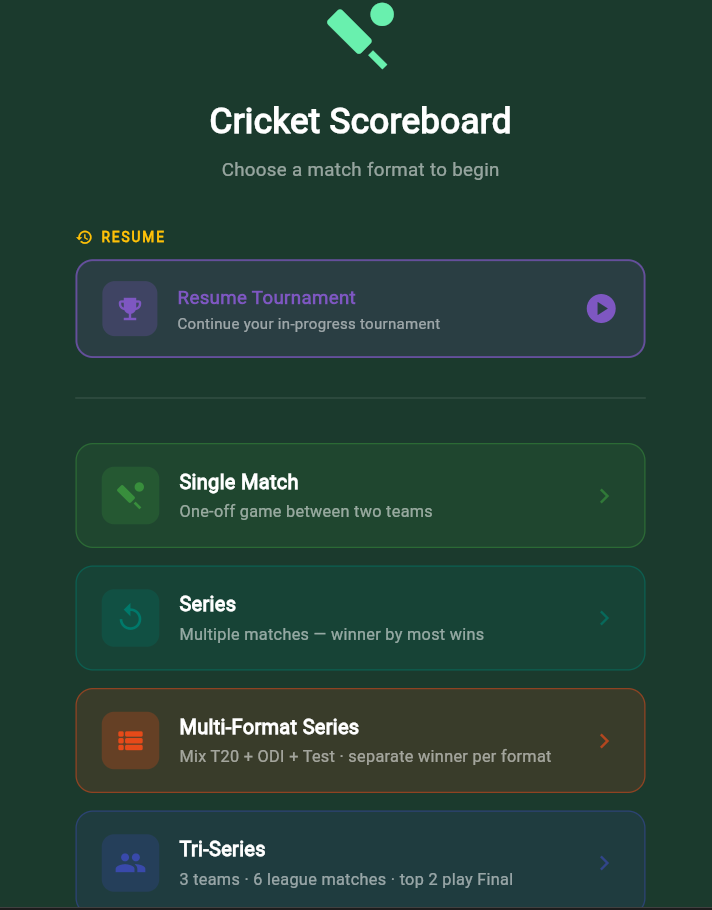
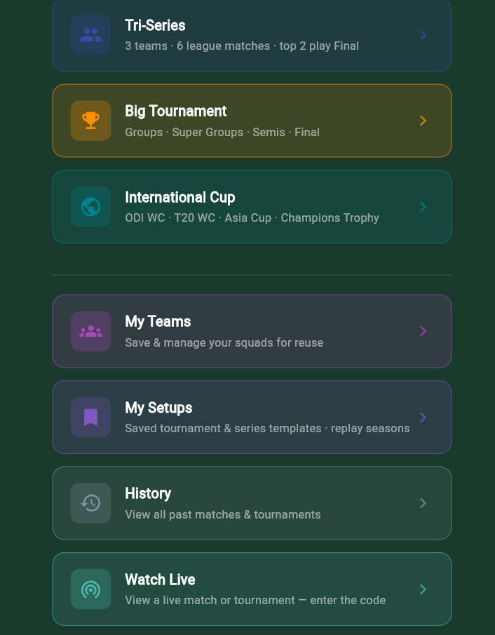
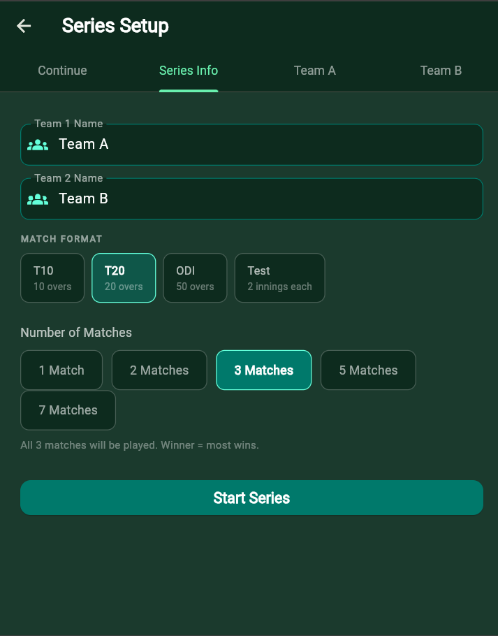
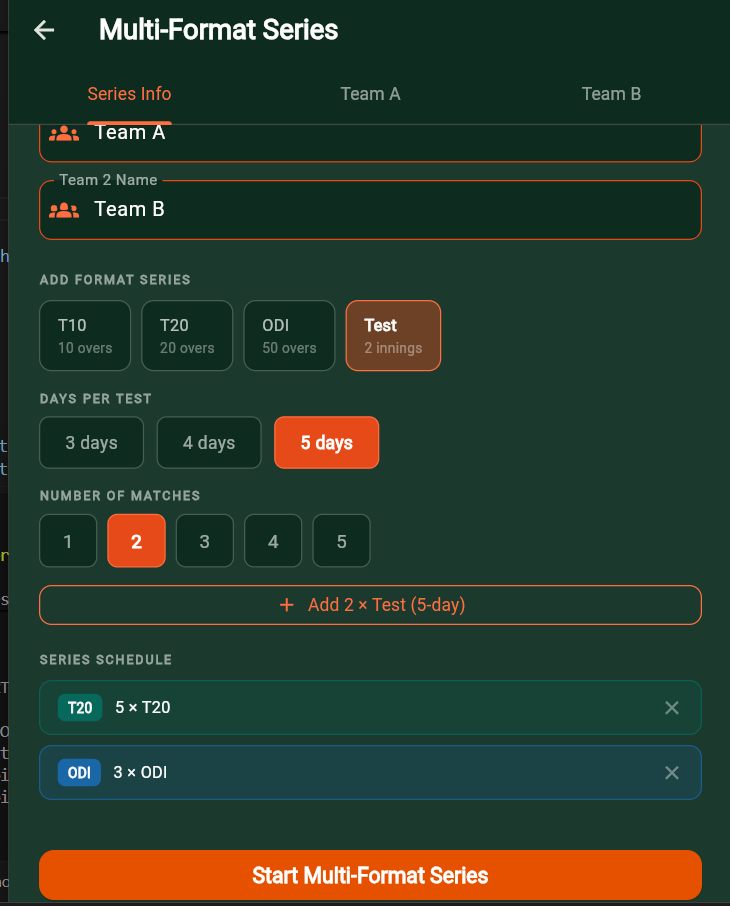
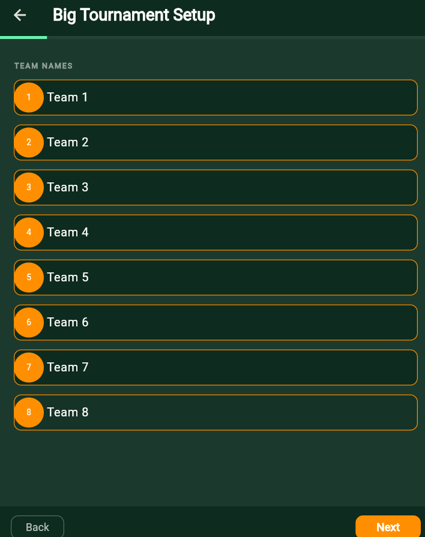
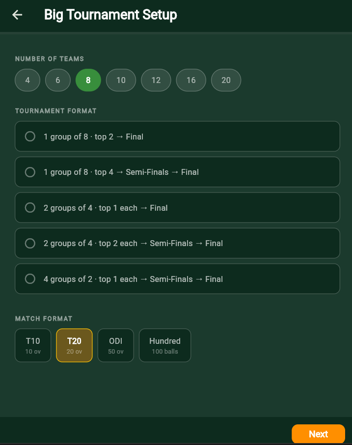
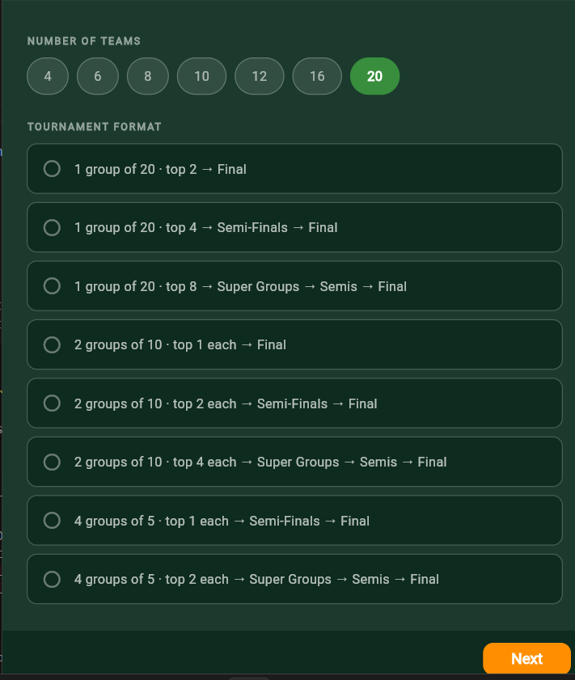

# 🏏 Cricket Scoreboard

A full-featured, offline cricket scoring app built with **Flutter**. Supports every major match format — from a quick T10 to a 5-day Test — with complete squad management, live scoring, scorecard generation, and multi-team tournament brackets.

---

## ✨ Features

### Match Modes
| Mode | Description |
|------|-------------|
| **Single Match** | One-off game between two teams (11 players each) |
| **Series** | Multiple matches; winner decided by most wins |
| **Multi-Format Series** | Mix of T20, ODI & Test in one series; separate winner per format |
| **Tri-Series** | 3 teams · 6 league matches · top 2 play the Final |
| **Big Tournament** | Full bracket: Groups → Super Groups → Semi-Finals → Final |

### Match Formats
- **T10** — 10 overs per side
- **T20** — 20 overs per side
- **ODI** — 50 overs per side
- **The Hundred** — 100 balls (sets of 5) per side
- **Test** — 3, 4, or 5 days · unlimited overs · 4 innings · follow-on logic

### Squad & Team Management
- Squads of **18–21 players** for all tournament modes (Quick Match stays at 11)
- Add / remove players dynamically during setup (min 18, max 21)
- Per-player roles: **Batter**, **Bowler** (Fast / Spin), **All-Rounder** (Fast / Spin)
- Designations: **Captain** (one per team) and **Wicket Keeper** (multiple WKs allowed in a squad)

### Playing XI Selector *(tournament modes)*
- Two-column layout — **Playing XI** on the left, **Bench** on the right
- Tap one player from each side, press **Change** to swap
- Swapped player lands at the **exact same position** (batting order preserved)
- **Flying tile animation** — both tiles visually fly across the screen to each other's position
- Change **Captain** and **WK** assignment directly in the XI screen
- Confirmation blocked until: 11 players selected · WK assigned · Captain assigned

### Live Scoring
- Ball-by-ball scoring with a tap interface
- Runs: 0 · 1 · 2 · 3 · 4 · 5 · 6
- Extras: **Wide** · **No Ball** · **Bye** · **Leg Bye** (with runs)
- **Wicket types**: Bowled · Caught · LBW · Run Out · Stumped · Hit Wicket · Obstructing the Field
- Wide + Stumping combination handled correctly
- Over history with per-ball log
- Automatic **maiden over** detection
- Strike rotation on odd runs, end of over, and run-outs

### Score Flash Animations
Fullscreen animated overlays on key events:

| Event | Colour | Size |
|-------|--------|------|
| **6** | Gold / Amber | 108 px |
| **4** | Blue | 108 px |
| **OUT!** | Red | 72 px |
| **Wide** | Orange | 50 px |
| **No Ball** | Amber | 50 px |

Bounce-in with `easeOutBack` → hold → fade/scale-out · total 1.1 s · non-blocking.

### Scorecard
- Full batting scorecard: runs · balls · 4s · 6s · SR · dismissal info
- Full bowling scorecard: overs · maidens · runs · wickets · economy
- **Fall of Wickets** table
- **Partnerships** table with individual contributions

### Tournament Features
- Live **points table** with NRR calculation
- Match bracket navigation (play any unplayed fixture in order)
- Per-match Playing XI selection before every fixture
- Semi-final / Final drawn automatically from group standings

### App Polish
- Animated **splash screen** — cricket icon bounces in · text wipes in · pulsing rings
- Smooth **slide + fade** page transitions on every screen (global `PageTransitionsTheme`)
- Dark cricket-green Material 3 theme throughout

---

## 📸 Screenshots

<p float="left">
  
  
  
  
</p>
<p float="left">
  
  
  
  
</p>

---

## 📁 Project Structure

```
lib/
├── main.dart                                   # App entry · global page transitions
├── models.dart                                 # Core models: Player, Innings, MatchState
├── tournament_models.dart                      # TournamentTeam, TournamentMatch, NRR
└── screens/
    ├── splash_screen.dart                      # Animated launch screen
    ├── mode_select_screen.dart                 # Home — choose a match mode
    ├── setup_screen.dart                       # Quick match setup (11 players)
    ├── squad_entry.dart                        # Reusable squad builder widget
    ├── series_setup_screen.dart                # Series setup
    ├── multi_format_series_setup_screen.dart   # Multi-format series setup
    ├── tri_series_setup_screen.dart            # Tri-series setup
    ├── big_tournament_setup_screen.dart        # Tournament bracket setup
    ├── playing_xi_screen.dart                  # XI selector with swap animation
    ├── toss_screen.dart                        # Coin toss before each match
    ├── match_screen.dart                       # Live scoring interface
    ├── scorecard_screen.dart                   # Post-match / mid-innings scorecard
    └── tournament_home_screen.dart             # Bracket, standings, match list
```

---

## 🚀 Getting Started

### Prerequisites
- [Flutter SDK](https://docs.flutter.dev/get-started/install) `>=3.4.4`
- Dart `>=3.4.4 <4.0.0`
- Any of: Chrome (web) · Android emulator/device · iOS simulator/device

### Run locally

```bash
# Clone the repository
git clone https://github.com/your-username/cricket-scoreboard.git
cd cricket-scoreboard

# Install dependencies
flutter pub get

# Run on Chrome (web)
flutter run -d chrome

# Run on Android
flutter run -d android

# Run on iOS
flutter run -d ios
```

### Build for production

```bash
# Web
flutter build web

# Android APK
flutter build apk --release

# iOS
flutter build ios --release
```

---

## 🕹️ How to Use

### Quick Match
1. Tap **Single Match** on the home screen
2. Enter team names, set 11 players per team (roles + designations)
3. Complete the **toss**, pick batting or fielding
4. Score ball by ball on the match screen
5. View the full scorecard at any time or after the match ends

### Series / Multi-Format Series
1. Choose **Series** or **Multi-Format Series**
2. Enter team names and configure a squad of **18–21 players** per team
3. For each match, select your **Playing XI** from the squad using the swap UI
4. Play all matches; the app tracks wins and determines the series winner

### Tri-Series
1. Choose **Tri-Series** and enter 3 team names with 18–21 player squads each
2. Play the 6 league fixtures; standings update in real time with NRR
3. Top 2 teams qualify — play the **Final** automatically

### Big Tournament
1. Choose **Big Tournament**, select the number of teams and group structure
2. Build squads for every team
3. Play Group → Super Group → Semi-Finals → Final
4. Points table and NRR tracked throughout

---

## 🛠️ Tech Stack

| Layer | Technology |
|-------|-----------|
| Framework | Flutter (Dart) |
| State management | `StatefulWidget` + `setState` (no external packages) |
| UI | Material 3 · Dark theme · Custom animations |
| Navigation | Flutter Navigator with `PageRouteBuilder` transitions |
| Platform | Web · Android · iOS |
| Dependencies | `flutter/material.dart` only — zero third-party packages |

---

## 🤝 Contributing

Pull requests are welcome. For major changes please open an issue first to discuss what you would like to change.

1. Fork the repository
2. Create a feature branch — `git checkout -b feature/your-feature`
3. Commit your changes — `git commit -m 'Add some feature'`
4. Push to the branch — `git push origin feature/your-feature`
5. Open a Pull Request

---

## 📄 License

This project is licensed under the MIT License — see the [LICENSE](LICENSE) file for details.

---

*Built with Flutter · No ads · No data collection · Fully offline*
